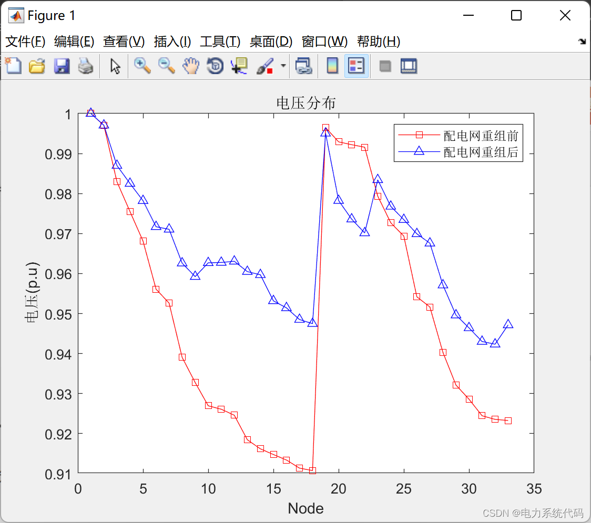
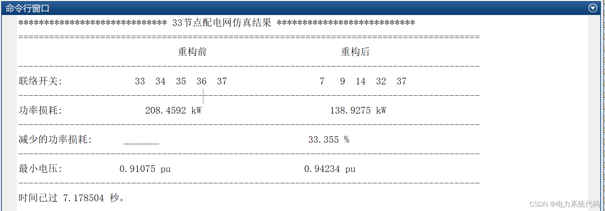

# Improved binary particle swarm optimization algorithm application in power distribution network reconfiguration (implemented in Matlab)

Improving the Binary Particle Swarm Algorithm in the Application of Reconstruction of Power Distribution Network (Matlab Implementation)

## Images

<!-- PAYMENT_BLOCK -->

## Get this dataset

- Payment link (Stripe): [Buy now](https://buy.stripe.com/3cs8yP7sY87d0vu9AB)
- Payment QR code: 

<!-- /PAYMENT_BLOCK -->
